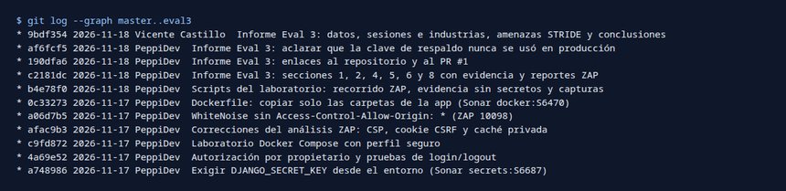

# Evaluación 3 – Desarrollo Seguro de Software

**CRUD Inventario: autenticación, datos, Docker y análisis dinámico con OWASP ZAP**

| | |
|---|---|
| Integrantes | Benjamín Ulloa · Vicente Castillo |
| Proyecto | CRUD Inventario (Django 5.2.18 LTS, Python 3.13), continuación de la Evaluación 2 |
| Rama de trabajo | `eval3` (sobre `master` = `94ae13b`, versión final de la Evaluación 2), integrada por el PR #1 |
| Versión analizada | Inicial `c9fd872` · Final `0c33273` (imagen `crud-inventario:0c33273`) |
| Repositorio / PR | https://github.com/PeppiDev/crud-inventario-seguro · https://github.com/PeppiDev/crud-inventario-seguro/pull/1 |
| Fecha | 18-11-2026 |

## 1. Identificación

**Objetivo.** La Evaluación 2 dejó un CRUD validado y sin vulnerabilidades abiertas en SonarQube, salvo un secreto en el código. En esta etapa agregamos control de acceso por usuario, inventariamos los datos que maneja la app, la empaquetamos en Docker con un perfil de laboratorio y la analizamos en ejecución con OWASP ZAP. Corregimos lo encontrado y verificamos las correcciones con un segundo análisis.

**Alcance del análisis dinámico.** Solo `http://127.0.0.1:8000`, publicado por Docker Compose en el equipo del laboratorio, con cuentas y datos ficticios. No escaneamos el despliegue público en PythonAnywhere ni sitios de terceros.

**Aportes de cada integrante.**

| Integrante | Aporte |
|---|---|
| Benjamín Ulloa | Autorización por propietario y permiso de supervisor; pruebas de login, logout y acceso; Dockerfile y Compose; recorridos y reportes ZAP; correcciones (CSP, cookies, caché, CORS, Dockerfile); análisis SonarQube; redacción de las secciones 1, 2, 4, 5, 6 y 8. |
| Vicente Castillo | Inventario de activos y comparación entre industrias; mecanismos de protección y sus límites; revisión de sesiones y cookies; amenazas STRIDE; revisión cruzada de hallazgos y del informe; redacción de las secciones 3 y 7; revisión y aprobación del PR #1 (pruebas, cabeceras, Docker y evidencia sin secretos). |

**Historial de cambios (rama `eval3`).**

| Commit | Cambio | Relación |
|---|---|---|
| `a748986` | Exigir `DJANGO_SECRET_KEY` desde el entorno | Sonar secrets:S6687 heredado |
| `4a69e52` | Propietario por producto, permiso `ver_todos`, correo enmascarado, 14 pruebas de acceso | Login y autorización |
| `c9fd872` | Dockerfile, `compose.yaml`, `.dockerignore`, `.env.example`, README, cuentas de prueba | Laboratorio Docker (versión del ZAP inicial) |
| `afac9b3` | CSP estricta, CSS externo, `csrftoken` HttpOnly, sesión de 8 h, `never_cache` | Hallazgos ZAP Z-01, Z-02 y caché |
| `a06d7b5` | WhiteNoise sin `Access-Control-Allow-Origin: *` | Hallazgo ZAP Z-06 |
| `0c33273` | Dockerfile copia solo las carpetas de la app | Sonar docker:S6470 (versión final) |
| `b4e78f0` | Scripts del laboratorio (`scripts/lab/`): recorrido ZAP, evidencia sin secretos, capturas | Reproducibilidad |
| `c2181dc` · `190dfa6` · `af6fcf5` | Informe y evidencia: secciones 1, 2, 4, 5, 6 y 8 (Benjamín) | Informe |
| `9bdf354` | Secciones 3, STRIDE y 7 (Vicente) | Informe |

{.term}

Figura 1. Historial de la rama eval3 (commits de ambos integrantes).

