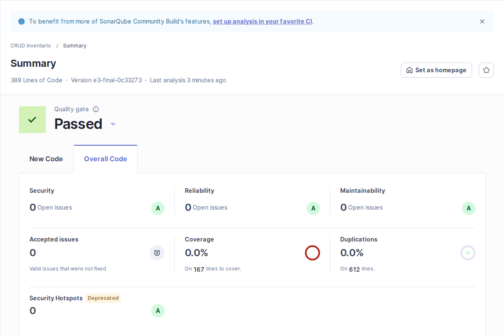
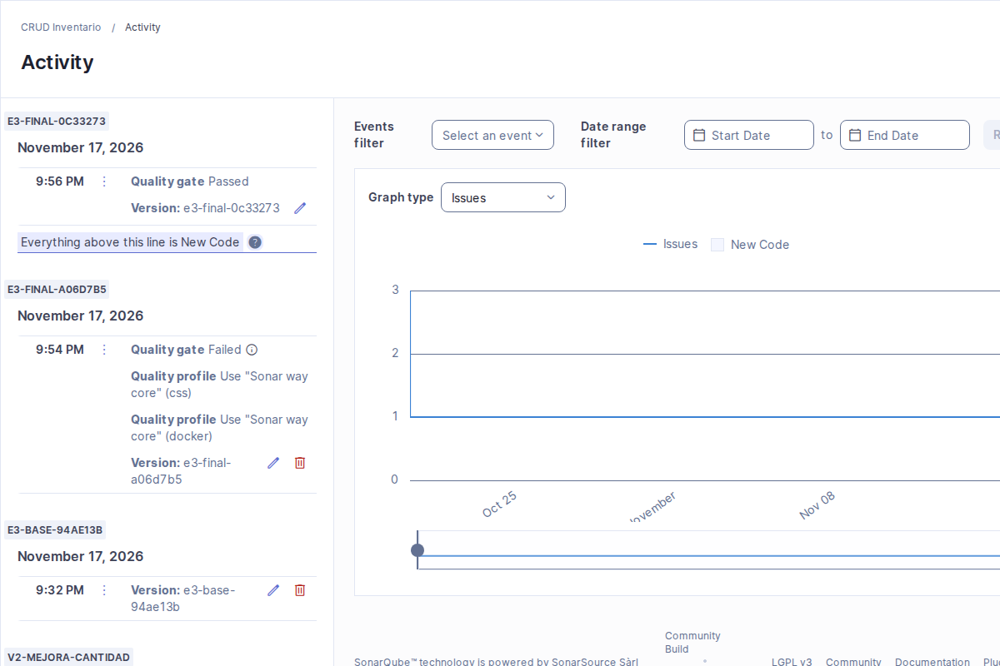
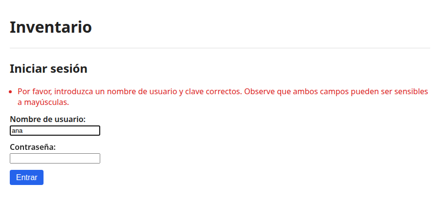
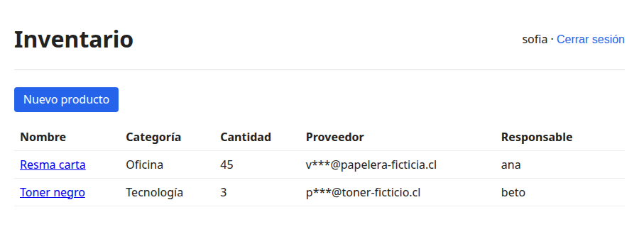
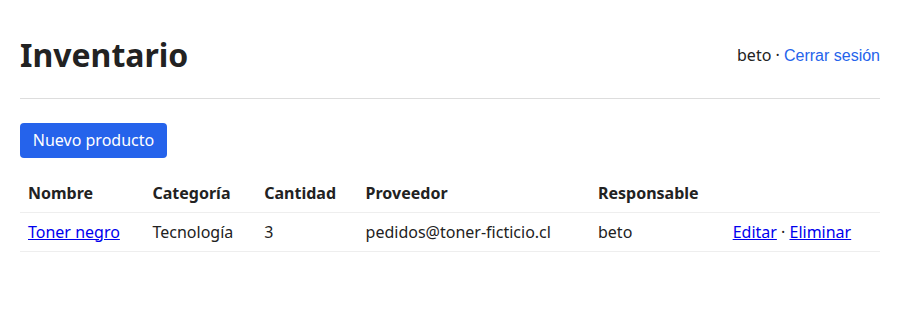
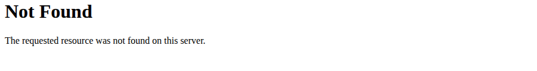
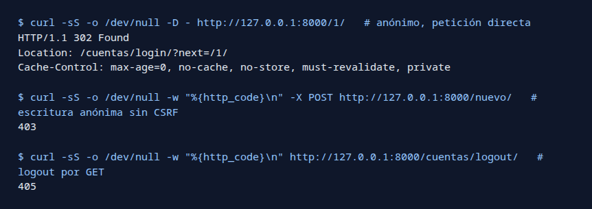

## 2. SonarQube y login

### 2.1 Continuidad de SonarQube

Analizamos con SonarQube Community 26.10 en un contenedor local. Para la base usamos el último commit de la Evaluación 2 (`94ae13b`) y para el cierre el commit final de esta etapa.

| Hallazgo heredado / nuevo | Regla | Archivo | Prioridad | Decisión | Commit |
|---|---|---|---|---|---|
| SECRET_KEY por defecto en el código | secrets:S6687 | `config/settings.py` L28 | Blocker | Corregir. La app no arranca sin la variable y la clave antigua (respaldo de desarrollo, nunca usada en producción) se da por revocada (queda en el historial). | `a748986` |
| Contraseña de prueba en tests (Eval 2) | S2068 / S6437 | `inventario/test_*.py` | Alta | Ya resuelto en Eval 2 al clasificar los tests como código de prueba; las contraseñas de prueba ahora salen de `secrets.token_urlsafe`. | `81cbd0b`, `4a69e52` |
| `COPY . .` en el Dockerfile (código nuevo) | docker:S6470 | `Dockerfile` L15 | Critical | Corregir. Se copia carpeta por carpeta, así un `.env` o una base de datos no entran a la imagen aunque falle `.dockerignore`. | `0c33273` |

**Antes (`94ae13b`):**

```python
SECRET_KEY = os.getenv('DJANGO_SECRET_KEY', 'django-insecure-[OCULTO]')
```

**Después (`a748986`):**

```python
SECRET_KEY = os.getenv('DJANGO_SECRET_KEY')
if not SECRET_KEY:
    raise ImproperlyConfigured('Falta la variable de entorno DJANGO_SECRET_KEY (ver .env.example).')
```

**Resultado final (`0c33273`).** 0 issues, 0 vulnerabilidades, 0 security hotspots, Security A y Quality Gate *Passed*, sobre 389 líneas. La actividad del proyecto muestra la base, el análisis intermedio (Quality Gate *Failed* por S6470) y el final.

{.chica} {.chica}
<p class="pie">Figura 2. SonarQube: resumen final y actividad (base 94ae13b → intermedio a06d7b5 → final 0c33273).</p>

### 2.2 Login, logout y autorización

Usamos la autenticación de Django (`LoginView`, `LogoutView`), con un perfil de acceso por rol:

| Rol | Ver listado / detalle | Crear | Editar / eliminar |
|---|---|---|---|
| Anónimo | No: 302 al login | No: 302 o 403 CSRF | No |
| Operador (ana, beto) | Solo sus productos | Sí, como propietario | Solo los suyos; lo ajeno da 404 |
| Supervisor (sofia, permiso `inventario.ver_todos`) | Todos, con el correo del proveedor enmascarado | Sí, los suyos | Solo los suyos; lo ajeno da 404 |

- **Propietario desde la sesión.** `CreateView` asigna `propietario = request.user`. El campo no es editable, así que un `propietario` enviado en el POST se ignora (prueba `test_crear_asigna_propietario_desde_la_sesion`).
- **Lectura y escritura filtradas.** `PropiosMixin.get_queryset()` filtra por propietario en editar y eliminar. `ConsultaMixin` usa ese mismo filtro para leer, salvo que el usuario tenga `ver_todos`. Un ID ajeno responde 404, no 403, para no confirmar que el registro existe (control de IDOR, CWE-639).
- **Logout.** Solo por POST con token CSRF: un GET devuelve 405 y un POST sin token devuelve 403.
- **Petición directa anónima.** `curl http://127.0.0.1:8000/1/` devuelve `302 Location: /cuentas/login/?next=/1/` y un POST anónimo a `/nuevo/` devuelve 403.

{.chica} {.chica}
<p class="pie">Figura 3. Login inválido rechazado · Supervisora: ve todos los productos con el correo enmascarado y la columna Responsable.</p>

{.chica} {.chica}

{.term}
<p class="pie">Figura 4. beto solo ve su producto y el de ana le responde 404 · Peticiones directas sin sesión: 302 al login, 403 (POST sin CSRF) y 405 (logout por GET).</p>

Las 34 pruebas automáticas pasan: 14 son de acceso (login, logout, anónimo, propietario, supervisor), 6 de cabeceras, 9 de validación (Eval 2) y 5 del CRUD. El detalle está en `evidencia/02-login-datos/tests_detalle.txt`.
