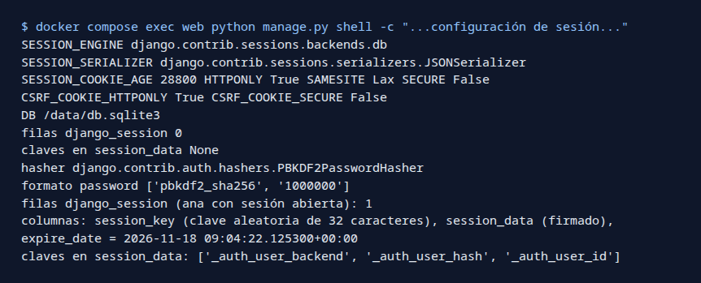

## 3. Datos, sesiones e industrias

### 3.1 Inventario de activos

| # | Activo | Tipo | Ubicación | Usuarios autorizados | Exposición | Solución tentativa / control |
|---|---|---|---|---|---|---|
| A1 | Correo del proveedor | Dato personal (identifica a una persona de contacto) | `inventario_producto.correo_proveedor` en `/data/db.sqlite3` | Propietario del registro (completo); supervisor (enmascarado); admin | HTML de listado y detalle, admin, respaldos, reportes de ZAP | Autorización por propietario, enmascarado `v***@dominio` para el supervisor y datos ficticios en el laboratorio |
| A2 | Registro de producto (nombre, categoría, cantidad, responsable) | Registro interno del negocio | `inventario_producto` | Propietario; supervisor solo lectura | CRUD web y admin | Filtrado por propietario, validación de rango y categoría (Eval 2) y CSRF en escrituras |
| A3 | Contraseñas de usuarios | Credencial | `auth_user.password` | Nadie las lee; Django solo verifica | Formulario de login | Hash PBKDF2-SHA256 con 1.000.000 de iteraciones; contraseñas de prueba aleatorias fuera del repo |
| A4 | Sesión autenticada | Credencial temporal | Cookie `sessionid` en el navegador + tabla `django_session` | El usuario dueño de la sesión | Tráfico HTTP, navegador | HttpOnly, SameSite=Lax, 8 h; Secure y HSTS con el perfil HTTPS; logout borra la fila |
| A5 | `SECRET_KEY` y `.env` | Secreto de configuración | Archivo `.env` en el anfitrión, inyectado como variable de entorno | Equipo de desarrollo | Repositorio (antes), imagen | Obligatoria desde el entorno; `.env` en `.gitignore` y `.dockerignore`; `COPY` explícito |
| A6 | Base de datos y respaldos | Contenedor de A1–A4 | Volumen `sqlite_data` | Operador del servidor | Copias del volumen | Sin cifrado en reposo (riesgo residual); nunca se versiona (`*.sqlite3` ignorado) |

### 3.2 Mecanismos de protección y sus límites

| Mecanismo | Dónde lo aplicamos | Límite |
|---|---|---|
| Minimización | Solo se guarda un correo de contacto, sin nombre, teléfono ni RUT del proveedor. | El correo sigue siendo dato personal y se puede cruzar con otras fuentes. |
| Autorización | `get_queryset` filtrado por propietario y permiso `ver_todos` solo de lectura. | No cubre al administrador ni a quien tenga acceso al archivo de la BD. |
| Enmascarado | `correo_enmascarado()` en las vistas del supervisor. | Es solo de presentación: la BD y el admin guardan el valor completo. |
| Hash | Contraseñas con PBKDF2 y sal por usuario. | No impide adivinar contraseñas débiles: falta limitar intentos (ver STRIDE). |
| Cifrado | HTTPS en PythonAnywhere (cookies Secure + HSTS con `DJANGO_HTTPS=True`). La sesión va firmada con `SECRET_KEY`. | El laboratorio es HTTP en loopback. SQLite no se cifra en reposo y la sesión va firmada, no cifrada. |

### 3.3 Comparación entre industrias: correo electrónico de una persona

| Aspecto | Comercio / inventario (este CRUD) | Salud (clínica) |
|---|---|---|
| Uso | Contactar al proveedor para reponer stock | Enviar resultados, citas y recetas al paciente |
| Daño si se filtra | Spam o phishing dirigido al proveedor; revela con quién compra la empresa | Revela que la persona es paciente y de qué especialidad: dato sensible, con posible discriminación |
| Acceso / exportación | Operador dueño del registro; supervisor enmascarado; sin exportación masiva | Solo personal tratante; exportar exige consentimiento o base legal y deja registro de auditoría |
| Control | Autorización por propietario + enmascarado | Control de acceso por rol clínico, cifrado en reposo, auditoría y consentimiento |
| Límite | No hay auditoría de quién consultó | Una ficha compartida entre equipos amplía el acceso; el riesgo humano sigue existiendo |

El mismo tipo de dato exige controles más fuertes en salud por el contexto en que aparece. En Chile, la Ley 19.628 (y la Ley 21.719, que la reemplaza) trata los datos de salud como sensibles, y la Ley 20.584 protege la ficha clínica.

### 3.4 Sesiones y cookies

- **Backend.** `django.contrib.sessions.backends.db` con serializador JSON. El navegador solo guarda la clave aleatoria de 32 caracteres en `sessionid`. Los datos quedan en el servidor, en la tabla `django_session` (`session_key`, `session_data` firmado, `expire_date`) dentro de `/data/db.sqlite3`.
- **Contenido.** Con una sesión abierta, la fila guarda `_auth_user_id`, `_auth_user_backend` y `_auth_user_hash` (HMAC del hash de la contraseña, que invalida la sesión si se cambia la contraseña). Al cerrar sesión, la fila se borra (0 filas tras el recorrido).
- **Cookies:**
  - `sessionid`: HttpOnly, SameSite=Lax, Max-Age 28800 (8 h; antes eran 2 semanas).
  - `csrftoken`: HttpOnly (antes no lo era), SameSite=Lax.
  - Ambas llevan Secure solo con el perfil HTTPS.

{.term}

Figura 5. Configuración de sesión dentro del contenedor y claves guardadas en django_session (sin valores).

