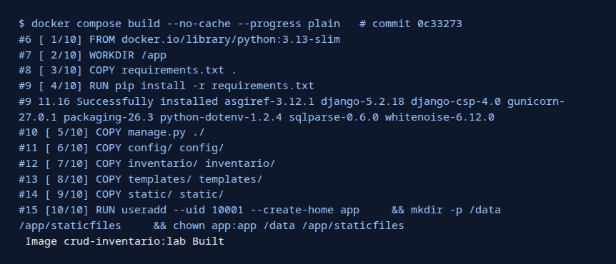
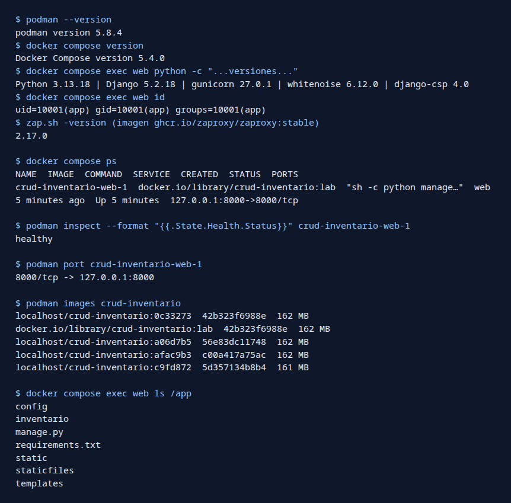
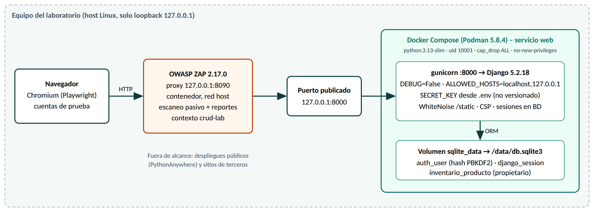

## 4. Docker

| Archivo | Contenido relevante |
|---|---|
| `Dockerfile` | `FROM python:3.13-slim` (imagen oficial), `pip install -r requirements.txt` en su propia capa, `COPY` explícito de `manage.py`, `config/`, `inventario/`, `templates/`, `static/`, usuario `app` uid 10001; el CMD ejecuta `migrate`, `collectstatic` y `gunicorn` en :8000. |
| `compose.yaml` | Servicio `web`. Publica `"127.0.0.1:8000:8000"`, solo en loopback. `env_file: .env`, `DJANGO_DEBUG=False` y `DJANGO_ALLOWED_HOSTS=localhost,127.0.0.1`. Volumen `sqlite_data:/data`, `cap_drop: ALL`, `no-new-privileges` y healthcheck. |
| `.dockerignore` / `.gitignore` | Excluyen `.venv`, `.env`, `.env.*` (salvo `.env.example`), `*.sqlite3`, `staticfiles`, logs y `.scannerwork`. |
| `.env.example` | Plantilla sin valores reales: `DJANGO_SECRET_KEY=` vacío, `DJANGO_HTTPS=False`. |
| `README.md` | Reglas de acceso, pasos del laboratorio (`cp .env.example .env`, generar clave, `docker compose up --build -d`, `crear_cuentas_prueba`), pruebas y análisis. |

**Versiones.** Python 3.13.18, Django 5.2.18, gunicorn 27.0.1, WhiteNoise 6.12.0 y django-csp 4.0, todos dentro del contenedor. Docker Compose 5.4.0 sobre Podman 5.8.4 y OWASP ZAP 2.17.0. El contenedor corre como `uid=10001(app)`, el healthcheck está `healthy` y la imagen pesa 162 MB.

{.term}

{.media}

Figura 6. Build sin caché del commit final (pasos del Dockerfile) · Versiones, docker compose ps, healthcheck, puerto 127.0.0.1:8000, imágenes por commit y contenido de /app.

Figura 7. Navegador → ZAP (proxy 127.0.0.1:8090) → puerto publicado 127.0.0.1:8000 → contenedor gunicorn/Django → volumen SQLite.

