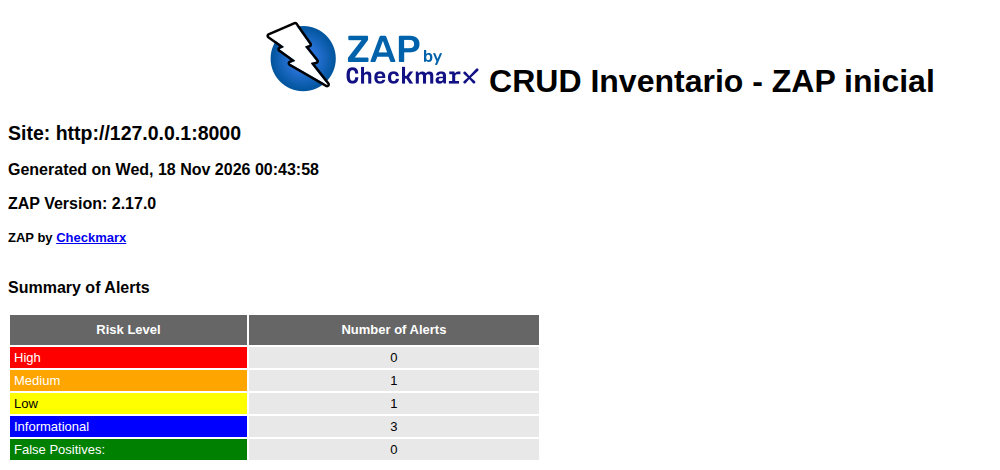
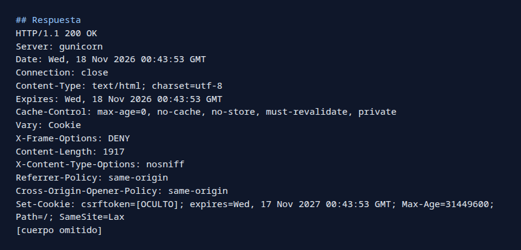
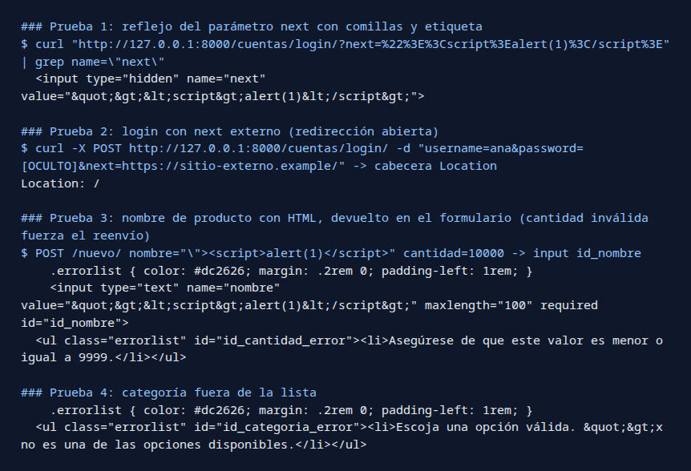

## 5. ZAP inicial

| Dato | Valor |
|---|---|
| Sesión / contexto | `crud-inicial` / `crud-lab` (regex `http://127\.0\.0\.1:8000.*`) |
| URL | `http://127.0.0.1:8000` (único host en el árbol Sites) |
| Fecha | 17-11-2026 21:43 (-03) |
| Versión | Código `c9fd872`, imagen `crud-inventario:c9fd872`, ZAP 2.17.0 en contenedor |
| Modo | Exploración manual reproducible con Chromium a través del proxy (`scripts/zap_lab.py`) + escaneo pasivo; sin escaneo activo |
| Mensajes | 58 peticiones, 20 URL |

**Recorrido.**

1. `/` sin sesión, que redirige al login.
2. Login inválido y login válido de ana.
3. Crear 2 productos y 1 rechazado (cantidad 10000).
4. Detalle y edición de `/1/`, eliminación de `/2/`.
5. Logout por POST.
6. beto pide `/1/`, `/1/editar/` y `/1/eliminar/` y recibe 404 en las tres.
7. sofia ve `/1/` (200) e intenta `/1/editar/` (404).
8. `/1/` sin sesión, que redirige al login.

Esperamos a que terminara el escaneo pasivo (`recordsToScan = 0`) y generamos los reportes `zap_inicial.html`, `.json` y `.md`.

{.chica} {.chica}

Figura 8. Reporte inicial: 1 Medium, 1 Low, 3 Informational · Respuesta del login (inicial): sin Content-Security-Policy y csrftoken sin HttpOnly.

**Hallazgos: identificación.**

| ID | Regla ZAP | Riesgo / confianza | URL · método · parámetro | Evidencia (sin secretos) | CWE |
|---|---|---|---|---|---|
| Z-01 | 10038 CSP Header Not Set | Medium / High | `/`, `/cuentas/login/`, `/nuevo/` GET y login POST (5) | Respuesta sin cabecera `Content-Security-Policy` (`manual/req_resp_login_GET.txt`) | 693 |
| Z-02 | 10010 Cookie No HttpOnly Flag | Low / Medium | Mismas 5 URL · `csrftoken` | `Set-Cookie: csrftoken=[OCULTO]; …; Path=/; SameSite=Lax` sin HttpOnly | 1004 |
| Z-03 | 10111 Authentication Request Identified | Info / High | POST `/cuentas/login/` · `username` / `password` | Formulario de login detectado | — |
| Z-04 | 10112 Session Management Response | Info / Medium | 16 respuestas · `csrftoken` | Cookie de sesión/CSRF emitida | — |
| Z-05 | 10031 User Controllable HTML Attribute | Info / Low | `next` (GET login) y `nombre`, `categoria`, `cantidad`, `correo_proveedor` (POST `/nuevo/`) | El valor enviado reaparece en un atributo `value` | 20 |
| M-01 | Revisión manual del recorrido | — | GET `/1/` | Página privada sin `Cache-Control` (`manual/req_resp_detalle_GET.txt`) | 525 |

**Hallazgos: tratamiento.** Todos se originan en la propia aplicación (configuración de Django y plantillas), así que el equipo es responsable de todos.

| ID | Decisión | Impacto | Prioridad | Medida |
|---|---|---|---|---|
| Z-01 | Corregir | Sin CSP, una inyección HTML no tiene una segunda barrera. El `<style>` inline impedía una CSP estricta. | Alta | CSS a un archivo estático y CSP `default-src 'self'`, sin `unsafe-inline`, con `frame-ancestors 'none'` y `form-action 'self'` |
| Z-02 | Corregir | Un script inyectado podría leer el token CSRF. | Media | `CSRF_COOKIE_HTTPONLY = True`: los formularios usan el campo oculto, no la cookie. |
| Z-03 | Aceptar (contextual) | Es informativo: el login existe por diseño. | Baja | Riesgo de fuerza bruta registrado en STRIDE (S-1). |
| Z-04 | Aceptar (contextual) | Informativo. | Baja | Revisamos los atributos de las cookies (sección 3.4). |
| Z-05 | Falso positivo | Django escapa `"` `<` `>` en los atributos (`&quot;&gt;&lt;script&gt;`). Un `next` externo redirige a `/`, así que no hay redirección abierta. | Baja | Verificación manual (figura 9); no requiere cambio |
| M-01 | Corregir (preventivo) | Un equipo compartido podría mostrar desde la caché un detalle ajeno con el correo. | Media | `never_cache` en las vistas privadas; sesión de 2 semanas a 8 h |

{.term}

Figura 9. Verificación manual de Z-05: el valor se escapa y el next externo no redirige afuera (la clave se reemplazó por [OCULTO]).

