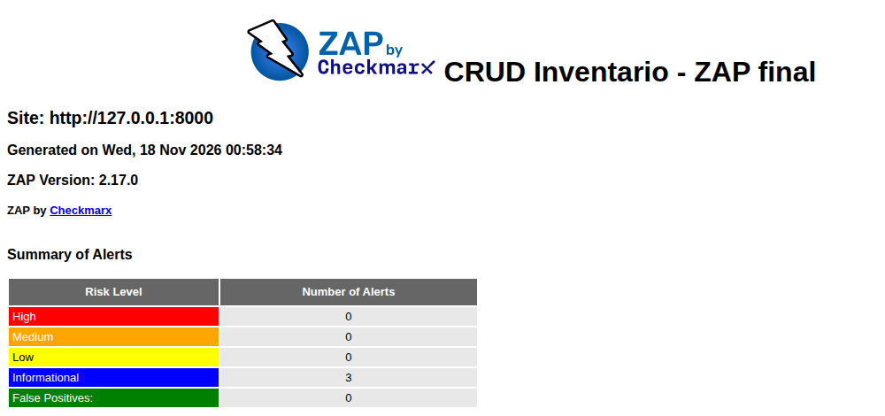
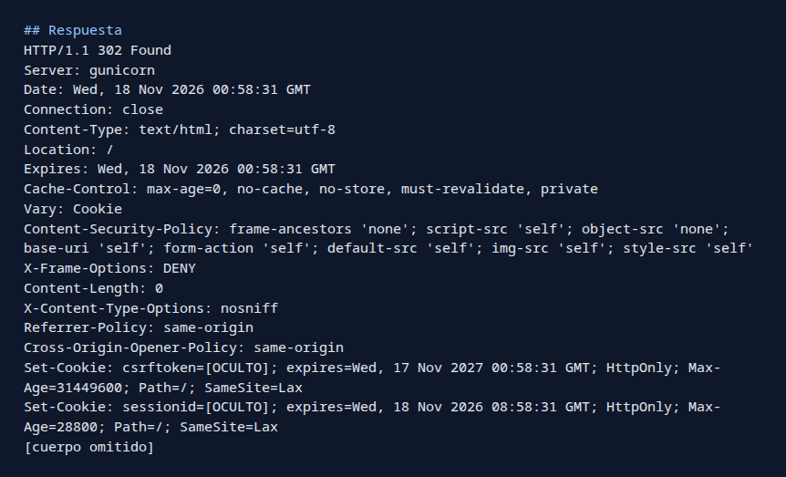
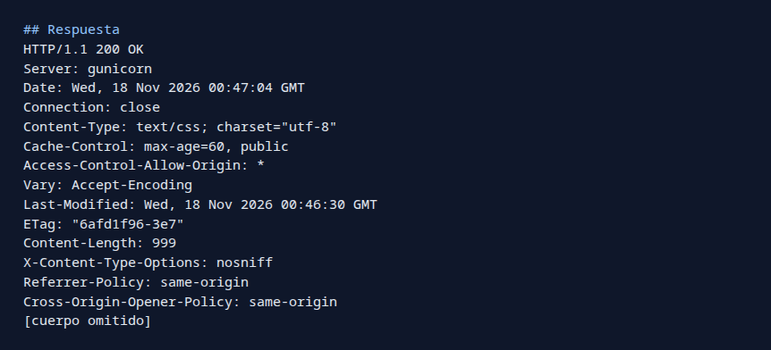

## 6. Correcciones y verificación

La verificación usó dos sesiones nuevas de ZAP, con el mismo contexto, el mismo recorrido y el mismo alcance (`127.0.0.1:8000`, sin otros hosts). La primera, sobre `afac9b3` a las 21:47, encontró un hallazgo nuevo: **Z-06**, 10098 Cross-Domain Misconfiguration (Medium, CWE-264), porque WhiteNoise respondía `/static/css/app.css` con `Access-Control-Allow-Origin: *`. Lo corregimos en `a06d7b5`. La sesión final sobre `0c33273`, a las 21:58, registró 61 mensajes y 23 URL; la diferencia con el inicial es el CSS nuevo.

| ID | Cambio | Commit | Prueba | Resultado ZAP final |
|---|---|---|---|---|
| Z-01 | CSP con django-csp y CSS externo, sin `style` inline | `afac9b3` | `test_csp_estricta_en_login_y_crud`, `test_html_sin_estilos_ni_scripts_inline` | **Resuelto**: cabecera CSP presente y alerta ausente |
| Z-02 | `CSRF_COOKIE_HTTPONLY = True` | `afac9b3` | `test_cookie_csrftoken_httponly` | **Resuelto**: `csrftoken` con HttpOnly |
| M-01 | `never_cache` en las vistas privadas y `SESSION_COOKIE_AGE` de 8 h | `afac9b3` | `test_paginas_privadas_no_se_guardan_en_cache`, `test_sesion_dura_una_jornada` | **Resuelto**: `Cache-Control: no-store` y `Max-Age=28800` |
| Z-06 | `WHITENOISE_ALLOW_ALL_ORIGINS = False` | `a06d7b5` | `test_css_sin_cors_abierto` | **Resuelto**: sin ACAO en el CSS |
| Z-03 / Z-04 | Ninguno (contextual) | — | Pruebas de login y logout | Se mantienen como informativos (esperado) |
| Z-05 | Ninguno (falso positivo) | — | Validación de Eval 2 y verificación manual | Se mantiene como informativo (6 instancias) |
| S6687 / S6470 | Secreto desde el entorno y `COPY` explícito | `a748986`, `0c33273` | Re-análisis SonarQube | **Resuelto**: 0 issues, QG Passed |

{.media}

{.term}

Figura 10. Reporte ZAP final: 0 High, 0 Medium, 0 Low, 3 Informational · Respuesta al login válido: CSP, no-store y cookies HttpOnly con sessionid de 8 h (valores ocultos).

{.term}

Figura 11. Z-06 en el análisis intermedio: Access-Control-Allow-Origin: * en el CSS (corregido en a06d7b5).

En el navegador, la consola no registró violaciones de CSP (solo los 404 esperados de las pruebas de acceso; ver `02-login-datos/consola_csp.txt`) y el CSS externo se aplica correctamente (figuras 3 y 4).
